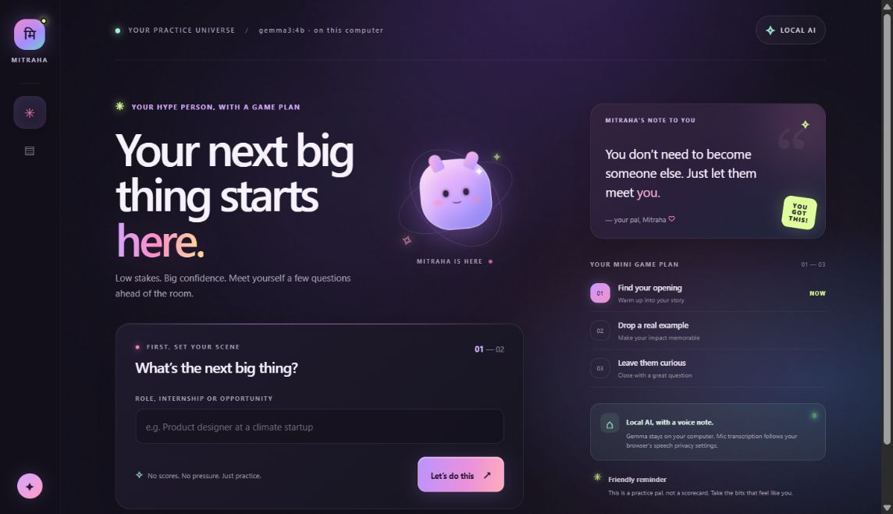
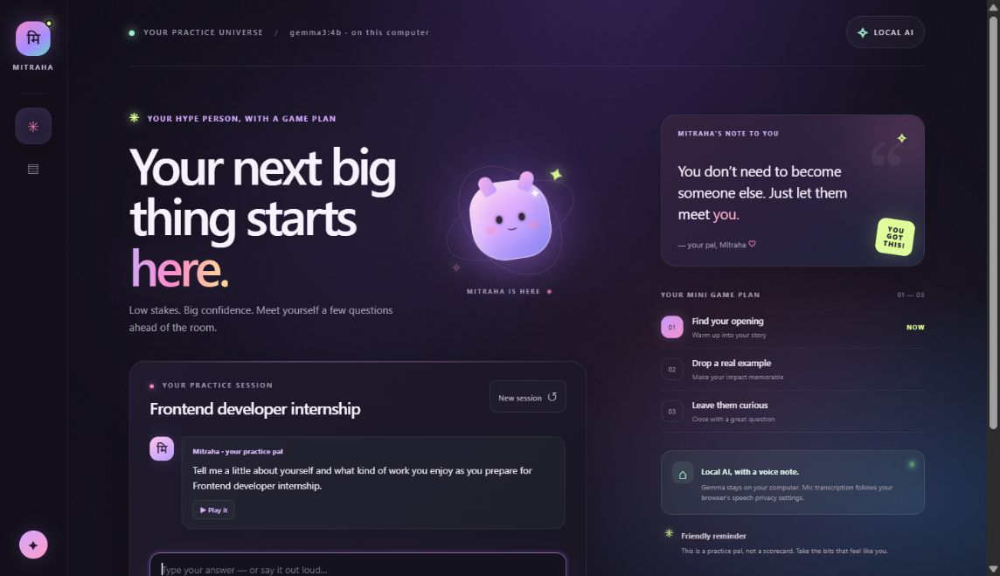
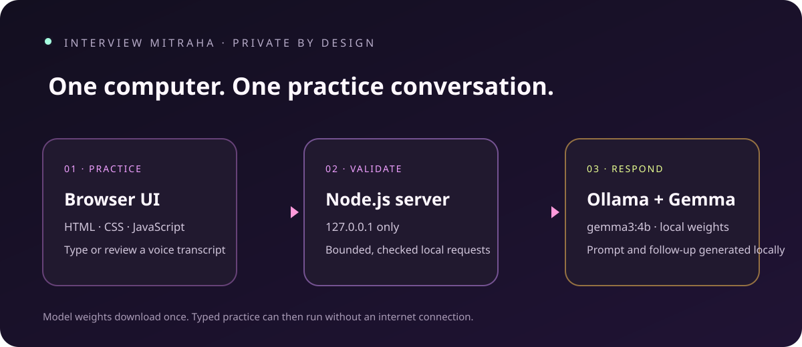

# Interview Mitraha



**A friendly, local-first interview practice partner powered by Gemma.**

Interview Mitraha gives a friend preparing for their next opportunity a low-pressure place to rehearse answers. It opens with one warm-up question, lets them type or speak a reply, and keeps the practice conversation on their own computer with Gemma 3 running through Ollama.

The name combines *Mitra* (friend) with the Sanskrit form *Mitraḥ* (मित्रः). The interface is designed to feel like a supportive practice pal: no scores, no accent ratings, and no claim that an AI can decide whether someone is ready for a job.

## What it does

- Starts a role-specific practice session with a gentle opening question.
- Sends answers to Gemma 3 4B through a local Ollama server.
- Supports typed answers and browser voice recognition in English, Hindi, and Hinglish.
- Shows a voice transcript for review before sending it to the model.
- Reads a Gemma reply aloud after voice practice when browser speech synthesis is available.
- Keeps the session in the current browser tab; there is no account, cloud model API, or conversation database.
- Offers a smaller Gemma model through an environment setting for computers with less memory.

## Screenshots

### Start a session


### Practice with voice or text



### How the pieces fit together



## Run it on Windows

You need Windows PowerShell, Node.js 20 or newer, and [Ollama](https://ollama.com/download). The first model download is about 3.3 GB and needs an internet connection; after that, typed practice and Gemma inference run locally.

From a PowerShell window in this repository:

```powershell
.\Start-Interview-Mitra.ps1
```

The launcher checks Ollama, downloads `gemma3:4b` if it is missing, starts the app on `127.0.0.1:4173`, and opens your browser. When you're done:

```powershell
.\Stop-Interview-Mitra.ps1
```

Or start the server manually:

```powershell
ollama pull gemma3:4b
npm.cmd start
```

Then visit <http://127.0.0.1:4173/>. To use a smaller model, pull it and set `OLLAMA_MODEL` before starting the server:

```powershell
ollama pull gemma3:1b
$env:OLLAMA_MODEL = 'gemma3:1b'
npm.cmd start
```

## Voice and privacy

Gemma inference and typed answers stay on the computer. The microphone uses the speech-recognition service supplied by the browser: some browsers support on-device recognition, while others may send audio to their configured speech service. Mitraha displays the transcript first; it reaches local Gemma only after the user presses **Send**. Browser speech synthesis reads replies aloud when available. Check your browser's microphone and speech privacy settings before voice practice.

No microphone hardware or permission flow is required to use the typed experience. Voice recognition, supported languages, and available voices depend on the browser and operating system.

## Open AI at the center

The model is not a decoration or a cloud fallback: Gemma generates the interviewer prompts and the follow-up conversation. Ollama exposes a local API, so no hosted model account or per-answer API bill is needed. Once the weights are downloaded, typed practice can work without an internet connection.

The open-weight setup also leaves the important choices in the user's hands. They can inspect and edit the system prompt, choose another compatible Ollama model, and keep the conversation on their own device. A closed hosted API would have made local data control and model swapping depend on that provider.

This is not a claim that voice input is always offline: browser speech recognition follows the browser's own implementation and privacy settings. Computer memory, model speed, and answer quality also vary by device and model.

## Under the hood

```text
Browser UI (HTML, CSS, JavaScript)
       │  same-origin HTTP; loopback only
       ▼
Node.js server (input limits, validation, security headers)
       │  local Ollama API
       ▼
Gemma 3 4B (downloaded and managed by Ollama)
```

There are no runtime npm dependencies. The server binds to loopback, validates messages and roles, limits request size and conversation context, and applies a timeout to Ollama requests. The browser does not persist a transcript after the tab is closed.

## Checks

Run the syntax checks and HTTP integration tests with:

```powershell
npm.cmd run check
```

The nine automated tests use a local mock Ollama endpoint, so they do not download or call a model. The finished interface was also opened in a browser and a real typed reply was exercised against the local Gemma model. Microphone capture was not tested because it depends on a user's hardware and browser permission.

## Challenge tags and GitHub labels

- DEV challenge tag: `hf26challenge` (required by the Hacktoberfest Weekend Challenge)
- Requested GitHub issue label: `hacktoberfest-2026`
- Other useful issue labels: `good first issue`, `help wanted`
- Suggested GitHub repository topics: `open-source-ai`, `gemma`, `ollama`, `interview-coach`

The DEV article's tag picker only accepts its registered tags; the challenge-required DEV tag is `hf26challenge`. `hacktoberfest-2026` is a GitHub issue label, not a substitute for the required DEV tag. Label definitions are kept in [.github/labels.json](.github/labels.json).

## Boundaries

Mitraha is a practice companion, not a hiring evaluator. It can make mistakes. Keep only suggestions that reflect your real experience, and never treat its wording as a promise of interview success.

## License

MIT. See [LICENSE](LICENSE).
