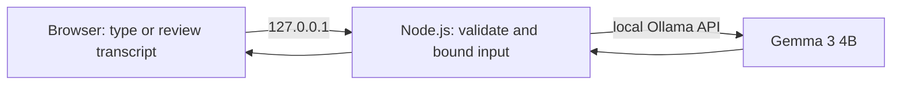

# DEV Challenge post draft

This is the human-reviewed submission copy for the Hacktoberfest Weekend Challenge. Replace the repository placeholder after the first successful GitHub push. The required DEV tag is `hf26challenge`; `hacktoberfest-2026` is the requested GitHub repository topic.

---
title: Interview Mitraha: a local Gemma practice pal for my friend
published: false
tags: devchallenge, hf26challenge, ai, opensource
---

*This is a submission for the [Hacktoberfest Weekend Challenge](https://dev.to/challenges/hacktoberfest-weekend-2026-10-01).*

## What I Built

Interview Mitraha is a small interview-practice app I built with a friend in India in mind. Preparing for an interview can feel awkward when every practice answer sounds like it needs to be perfect. I wanted to make a calmer first step: choose the role, get one friendly question, and practise in your own words.

You can type an answer or use voice input in English, Hindi, or Hinglish. Mitraha shows a voice transcript before you send it, then asks a follow-up as a supportive practice partner. It deliberately avoids accent scores and job-readiness grades. The goal is to help someone find their words, not judge whether they deserve the opportunity.

I have not shared the app with my friend for feedback yet, so I am not claiming a handoff or quoting a reaction. That is the next real-world check I want to make.

## Demo

The demo runs on the user's own computer at <http://127.0.0.1:4173/> after installing Ollama and Node.js. The launcher downloads Gemma the first time. I have not deployed a public hosted demo; the local setup is part of the privacy design.

## Code

**Repository:** [GitHub link will be added after the first push](#)

The requested GitHub issue label for this project is `hacktoberfest-2026`. The official required DEV challenge tag is `hf26challenge`.

## How I Built It

The app is a small browser interface served by a loopback-only Node.js server. For every practice response, the server calls Ollama on the same computer and uses the open-weight `gemma3:4b` model. There is no hosted model API or account in the request path.

The request flow is intentionally direct:

Ollama downloads the model weights once (about 3.3 GB). After that, typed practice and Gemma inference can work without internet. Users can change the model through Ollama's normal model names and the `OLLAMA_MODEL` setting. I also included the nine HTTP integration tests; they use a mock local Ollama endpoint and do not download a model.

Voice needs an honest footnote: the microphone uses the browser's speech-recognition API. Some browsers can recognize speech on-device; others may send audio to their configured speech service. Mitraha lets the user review the transcript before it is sent, and sending it only calls the local Gemma server. Browser text-to-speech reads a response when available.

## Why Does Open Innovation Matter?

For interview practice, the answer itself can feel personal. Running Gemma through Ollama means typed answers and model inference stay on the learner's computer. There is no cloud account to create, no per-answer API cost, and no vendor deciding how long a conversation is retained. After the one-time model download, typed sessions can run offline.

Open weights also make the app easier to adapt. A user can inspect the prompt that shapes Mitraha's tone, change it, or swap to a smaller compatible Gemma model if their computer has less memory. A closed API could provide a polished response, but it could not give this same local control over the model and the conversation path.

I did not make the same offline claim for voice: speech recognition depends on the browser's implementation and privacy settings. Model speed also depends on the computer. That trade-off is visible in the UI instead of hidden behind an “AI is private” promise.

## Prize Categories

- Best Use of Gemma

